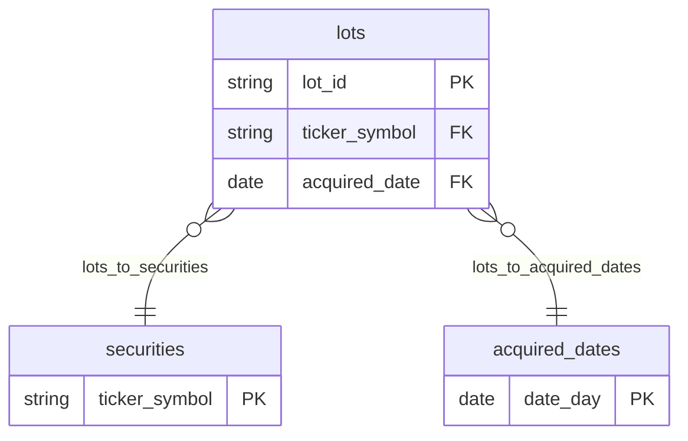
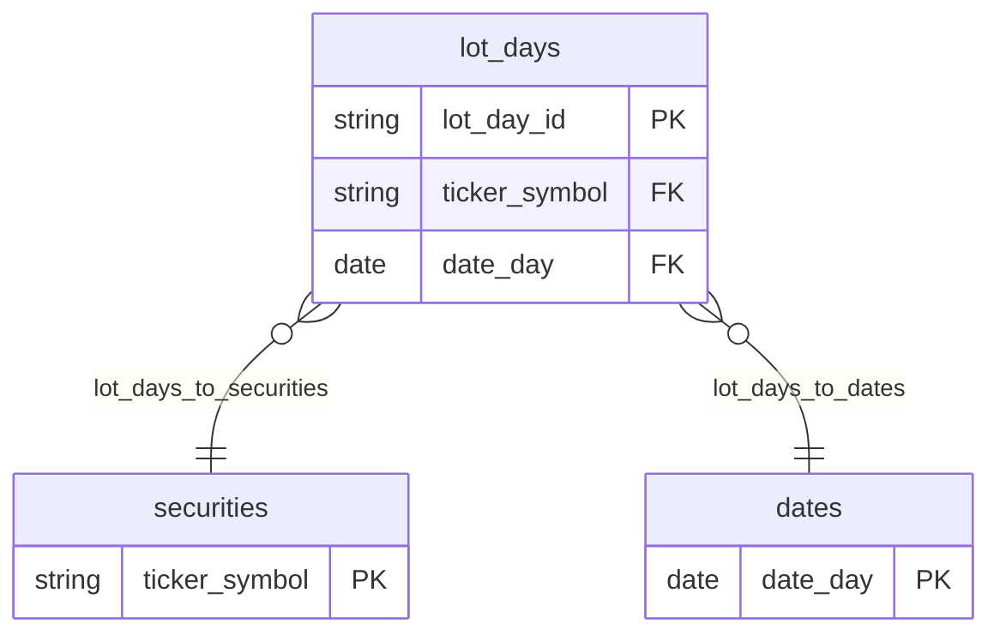

# Finance semantic views

| View | Grain | Purpose |
| --- | --- | --- |
| `sv_investment_lots` | purchase lot (`fct_investment_lots`) | Current and lifetime returns per purchase, rolled up to ticker, sector, category, purchase year, or the whole portfolio. Includes sold lots. |
| `sv_investment_positions` | lot × day (`fct_investment_lot_daily_values`) | Portfolio value over time (point-in-time metrics, one `date_day`) and purchases / sales / dividends over any period (flow metrics). |

Time-weighted and trailing-period returns (YTD, 1Y, 3Y) need window functions, so
they live in the `metrics_investment_returns_daily` table, not a semantic view.

## sv_investment_lots

## sv_investment_positions

